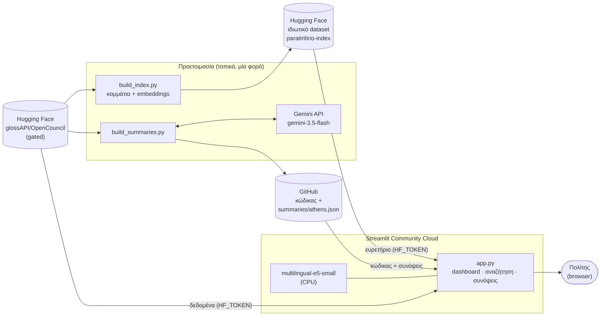

# 🏛️ Δημοτικό Παρατηρητήριο

**Ομάδα:** ΔΗΜΟΤΙΚΑ ΣΥΜΒΟΥΛΙΑ ΥΠΟ ΤΟ ΜΙΚΡΟΣΚΟΠΙΟ (ΜΠΕΛΛΑ - ΘΕΟΦΑΝΟΠΟΥΛΟΥ)

**Δημόσια εφαρμογή:** <https://dimotiko-paratiritirio.streamlit.app>

Το Δημοτικό Παρατηρητήριο είναι μια διαδικτυακή εφαρμογή που βοηθά τους πολίτες να παρακολουθούν τι συζητιέται και τι αποφασίζεται στα δημοτικά συμβούλια. Βασίζεται στο ανοιχτό dataset **OpenCouncil** και συνδυάζει ένα dashboard με στατιστικά ανά δήμο, σημασιολογική αναζήτηση μέσα στις συζητήσεις και αυτόματες συνόψεις συνεδριάσεων με μεγάλο γλωσσικό μοντέλο (LLM).

Οδηγίες χρήσης για μη τεχνικούς χρήστες: [USER_GUIDE.md](USER_GUIDE.md).

---

## Περιεχόμενα

1. [Λειτουργίες](#λειτουργίες)
2. [Δεδομένα](#δεδομένα)
3. [Αρχιτεκτονική](#αρχιτεκτονική)
4. [Τεχνολογίες και γιατί τις διαλέξαμε](#τεχνολογίες-και-γιατί-τις-διαλέξαμε)
5. [Δομή αρχείων](#δομή-αρχείων)
6. [Τοπική εκτέλεση (Windows)](#τοπική-εκτέλεση-windows)
7. [Δημιουργία ευρετηρίου και συνόψεων](#δημιουργία-ευρετηρίου-και-συνόψεων)
8. [Δημοσίευση στο Streamlit Community Cloud](#δημοσίευση-στο-streamlit-community-cloud)
9. [Αποτελέσματα αξιολόγησης](#αποτελέσματα-αξιολόγησης)
10. [Περιορισμοί](#περιορισμοί)
11. [Ανάπτυξη με coding agent](#ανάπτυξη-με-coding-agent)

---

## Λειτουργίες

Όλη η εφαρμογή είναι σε μία σελίδα. Ο χρήστης διαλέγει δήμο από την πλαϊνή μπάρα και η σελίδα ενημερώνεται.

### Dashboard ανά δήμο

- **Βασικά νούμερα:** αριθμός συνεδριάσεων, αριθμός θεμάτων, ποσοστό θεμάτων με απομαγνητοφώνηση και ποσοστό θεμάτων με καταγεγραμμένη ψηφοφορία.
- **Γραφήματα:** συνεδριάσεις ανά μήνα (μαζί με τους μήνες χωρίς συνεδρίαση) και οι 10 πιο συχνές θεματικές.
- **Θέματα συνεδρίασης:** επιλογή συνεδρίασης (νεότερη πρώτα) και πίνακας με τα θέματά της, με τη σειρά της ημερήσιας διάταξης: τίτλος, θεματική, αποτέλεσμα ψηφοφορίας, ένδειξη απομαγνητοφώνησης και σύνδεσμος στο PDF της απόφασης.
- Όταν υπέρ, κατά και λευκά είναι όλα 0, η εφαρμογή γράφει **«Δεν καταγράφηκε ψηφοφορία»** αντί να δείχνει μηδενικά, γιατί στα δεδομένα το 0-0-0 σημαίνει ότι δεν υπάρχει πληροφορία, όχι ότι κανείς δεν ψήφισε.

### Σημασιολογική αναζήτηση

- Ο χρήστης γράφει μια ερώτηση (π.χ. «παιδική φτώχεια») και παίρνει τα 10 πιο σχετικά αποσπάσματα από τις απομαγνητοφωνήσεις, στον επιλεγμένο δήμο ή σε όλους.
- Η αναζήτηση βρίσκει αποσπάσματα με **παρόμοιο νόημα**, όχι μόνο με τις ίδιες λέξεις (π.χ. η «καθαριότητα» βρίσκει και συζητήσεις για αποκομιδή απορριμμάτων).
- Για κάθε αποτέλεσμα φαίνονται ο δήμος, η ημερομηνία, ο τίτλος του θέματος, το απόσπασμα και σύνδεσμος στη συνεδρίαση στο OpenCouncil.gr.
- Κάτω από το πεδίο φαίνεται πόσα θέματα του δήμου καλύπτει η αναζήτηση. Αν ο δήμος δεν έχει καθόλου απομαγνητοφωνήσεις, εμφανίζεται σχετικό μήνυμα.

### Συνόψεις με LLM

- Για κάθε συνεδρίαση της **Αθήνας** (53 συνεδριάσεις) υπάρχει αυτόματη σύνοψη σε 4–6 κουκκίδες: κύρια θέματα, τι αποφασίστηκε και πού υπήρξε διαφωνία.
- Οι συνόψεις φτιάχτηκαν **εκ των προτέρων** με το Gemini (`gemini-3.5-flash`) και αποθηκεύτηκαν στο [summaries/athens.json](summaries/athens.json). Η online εφαρμογή απλώς τις διαβάζει, άρα δεν χρειάζεται κλειδί API ούτε κάνει κλήσεις σε LLM.
- Το prompt ζητάει ρητά να μην επινοείται τίποτα που δεν υπάρχει στο κείμενο. Το ακριβές prompt είναι καταγεγραμμένο στο [PROMPTS.md](PROMPTS.md#το-prompt-που-στέλνεται-στο-gemini).
- Κάθε σύνοψη συνοδεύεται από την προειδοποίηση «Η σύνοψη δημιουργήθηκε αυτόματα και μπορεί να περιέχει λάθη».

---

## Δεδομένα

### Πηγή

- **Dataset:** [glossAPI/OpenCouncil](https://huggingface.co/datasets/glossAPI/OpenCouncil) στο Hugging Face, αρχείο `open_council_20260603.parquet` (~74 MB).
- **Πρόσβαση:** το dataset είναι **gated**. Χρειάζεται λογαριασμός στο Hugging Face, αποδοχή των όρων στη σελίδα του dataset και token.
- **Αρχική πηγή:** τα δεδομένα προέρχονται από την πλατφόρμα [OpenCouncil.gr](https://opencouncil.gr), που καταγράφει και απομαγνητοφωνεί συνεδριάσεις δημοτικών συμβουλίων.
- **Μορφή:** κάθε γραμμή είναι ένα **θέμα** (subject) μιας συνεδρίασης, με στοιχεία όπως δήμος, συνεδρίαση, ημερομηνία, τίτλος, θεματική, ψήφοι υπέρ/κατά/λευκά, σύνδεσμος στο PDF της απόφασης και η απομαγνητοφώνηση της συζήτησης.

Επειδή το dataset είναι gated, **δεν ανεβάζουμε δεδομένα ή αποσπάσματα στο GitHub**. Ο φάκελος `data/` εξαιρείται στο `.gitignore`, το ευρετήριο αναζήτησης βρίσκεται σε ιδιωτικό dataset στο Hugging Face και το φύλλο αξιολόγησης μένει στον φάκελο `evaluation/private/`, που επίσης εξαιρείται.

### Τι βρήκαμε στην εξερεύνηση

Η εξερεύνηση έγινε με το [explore.py](explore.py) και τα πλήρη αποτελέσματα είναι στο [summary.txt](summary.txt).

| | |
|---|---|
| Θέματα (γραμμές) | 7.036 |
| Δήμοι | 25 |
| Μεγαλύτεροι δήμοι σε θέματα | Χανιά (2.680 θέματα, 100 συνεδριάσεις), Αθήνα (1.677 θέματα, 53 συνεδριάσεις) |
| Χρονικό εύρος | Αύγουστος 2024 – Ιούνιος 2026 (διαφέρει πολύ ανά δήμο) |
| Μέσο μήκος απομαγνητοφώνησης | ~2.200 χαρακτήρες ανά θέμα |

**1. Η κάλυψη των απομαγνητοφωνήσεων είναι άνιση.** Μόνο 3.293 από τα 7.036 θέματα (~47%) έχουν απομαγνητοφώνηση. Η Αθήνα έχει 88% και τα Βριλήσσια 91%, ενώ τα Χανιά, ο μεγαλύτερος δήμος, μόλις 24%. **Εννέα δήμοι δεν έχουν καμία απομαγνητοφώνηση** (Βάρη Βούλα Βουλιαγμένη, Βέροια, Καλαμάτα, Δωρίδα, Αττική, Πάτρα, Νέα Σμύρνη, Ρόδος, Περιστέρι). Οι δήμοι αυτοί υπάρχουν στο dashboard, αλλά δεν δίνουν αποτελέσματα στην αναζήτηση.

**2. Οι ψηφοφορίες είναι αραιές.** Τα πεδία ψήφων έχουν τιμή σε όλες τις γραμμές, αλλά στις περισσότερες είναι 0-0-0. Μόνο **415 από τα 7.036 θέματα (~6%)** έχουν πραγματικά καταγεγραμμένη ψηφοφορία, και 13 δήμοι δεν έχουν καμία. Γι' αυτό η εφαρμογή γράφει «Δεν καταγράφηκε ψηφοφορία» αντί για μηδενικά. Στην αξιολόγηση είδαμε επίσης ότι κάποιες ψηφοφορίες αναφέρονται μέσα στην απομαγνητοφώνηση, ενώ τα πεδία ψήφων είναι κενά.

**3. Τα ονόματα ομιλητών είναι κενά.** Στο `speaker_turns_json` τα πεδία `speaker_name` και `speaker_id` είναι κενά. Υπάρχει μόνο ένα `speaker_tag_id`, που ξεχωρίζει τους ομιλητές μέσα σε μία συνεδρίαση αλλά όχι από συνεδρίαση σε συνεδρίαση. Γι' αυτό η εφαρμογή **δεν** δείχνει στατιστικά ανά σύμβουλο ή παράταξη.

**4. Το `meeting_id` δεν είναι μοναδικό.** Το ίδιο αναγνωριστικό (π.χ. `may29_2026`) εμφανίζεται σε διαφορετικούς δήμους, οπότε η εφαρμογή χρησιμοποιεί ως κλειδί τον συνδυασμό δήμου και `meeting_id`.

---

## Αρχιτεκτονική

Η εφαρμογή έχει δύο φάσεις: την **προετοιμασία**, που γίνεται μία φορά τοπικά, και την **εκτέλεση**, που γίνεται online σε κάθε επίσκεψη.



**Πώς δουλεύει η αναζήτηση:**

1. Το `build_index.py` παίρνει τα θέματα με απομαγνητοφώνηση, τα χωρίζει σε κομμάτια των ~200 λέξεων με επικάλυψη 40 λέξεων και υπολογίζει για καθένα ένα διάνυσμα (embedding). Το αποτέλεσμα είναι 15.949 κομμάτια με διανύσματα 384 διαστάσεων.
2. Στην εφαρμογή, η ερώτηση του χρήστη μετατρέπεται σε διάνυσμα με το ίδιο μοντέλο.
3. Υπολογίζεται η ομοιότητα συνημιτόνου με όλα τα κομμάτια (ένα απλό γινόμενο πινάκων με NumPy) και επιστρέφονται τα 10 καλύτερα.

Λόγω του μικρού μεγέθους (~25 MB embeddings) δεν χρειάζεται βάση δεδομένων διανυσμάτων: όλο το ευρετήριο χωράει στη μνήμη.

**Cache:** τα δεδομένα φορτώνονται με `st.cache_data`. Το μοντέλο και το ευρετήριο φορτώνονται με `st.cache_resource`, ώστε να υπάρχει ένα κοινό αντίγραφο για όλους τους χρήστες. Αν το ευρετήριο δεν μπορεί να φορτωθεί, η υπόλοιπη σελίδα δουλεύει κανονικά χωρίς αναζήτηση.

---

## Τεχνολογίες και γιατί τις διαλέξαμε

| Τεχνολογία | Χρήση | Γιατί |
|---|---|---|
| **Python 3.12** | Γλώσσα | Σταθερή έκδοση που υποστηρίζεται από όλες τις βιβλιοθήκες του project, και η έκδοση για την οποία υπάρχει το έτοιμο wheel του PyTorch για CPU που χρησιμοποιούμε στο Linux. Την ίδια έκδοση χρησιμοποιούμε τοπικά και online, για να αποφεύγουμε διαφορές. |
| **Streamlit** | Διεπαφή χρήστη | Φτιάχνει διαδραστική σελίδα μόνο με Python, χωρίς HTML/JavaScript. Έχει έτοιμη cache και δωρεάν φιλοξενία (Community Cloud). |
| **pandas + pyarrow** | Επεξεργασία δεδομένων | Διαβάζουν γρήγορα το parquet και φορτώνουν μόνο τις στήλες που χρειάζονται. |
| **Plotly** | Γραφήματα | Διαδραστικά γραφήματα (hover, zoom) που ενσωματώνονται εύκολα στο Streamlit. |
| **huggingface_hub** | Λήψη αρχείων | Κατεβάζει το gated dataset και το ιδιωτικό ευρετήριο με token. |
| **sentence-transformers** + **intfloat/multilingual-e5-small** | Embeddings για αναζήτηση | Μικρό πολυγλωσσικό μοντέλο (~470 MB, 384 διαστάσεις) με καλή υποστήριξη ελληνικών, που τρέχει σε CPU. Χωράει στα όρια μνήμης της δωρεάν φιλοξενίας. |
| **NumPy** | Υπολογισμός ομοιότητας | Για ~16.000 κομμάτια, ένα γινόμενο πινάκων είναι αρκετά γρήγορο και δεν χρειάζεται ξεχωριστή βάση διανυσμάτων. |
| **PyTorch (CPU)** | Εκτέλεση μοντέλου | Απαιτείται από το sentence-transformers. Η έκδοση μόνο για CPU είναι πολύ μικρότερη από αυτή με CUDA. |
| **Gemini API** (`google-genai`) | Συνόψεις | Το μοντέλο Flash έχει δωρεάν επίπεδο και γράφει καλά ελληνικά. Χρησιμοποιείται μόνο τοπικά. |
| **python-dotenv** | Κλειδί API | Διαβάζει το `GEMINI_API_KEY` από το `.env`, ώστε το κλειδί να μη γράφεται ποτέ στον κώδικα. |
| **openpyxl** | Φύλλο αξιολόγησης | Δημιουργεί και διαβάζει το xlsx της αξιολόγησης. |
| **Streamlit Community Cloud** | Φιλοξενία | Δωρεάν, με απευθείας σύνδεση στο GitHub και ~2,7 GB μνήμη. Το Hugging Face Spaces απαιτούσε πλέον πληρωμένο πλάνο για εφαρμογές Streamlit. |

---

## Δομή αρχείων

```text
dimotiko-paratiritirio/
├── app.py                    # Η εφαρμογή Streamlit: dashboard, αναζήτηση και εμφάνιση συνόψεων
├── explore.py                # Εξερεύνηση του dataset· γράφει τα στατιστικά στο summary.txt
├── summary.txt               # Αποτελέσματα της εξερεύνησης (κάλυψη, ψηφοφορίες, ομιλητές ανά δήμο)
├── build_index.py            # Φτιάχνει το ευρετήριο αναζήτησης (κομμάτια + embeddings) στο data/
├── build_summaries.py        # Φτιάχνει τις συνόψεις συνεδριάσεων με το Gemini στο summaries/
├── summaries/
│   └── athens.json           # Οι 53 έτοιμες συνόψεις της Αθήνας (διαβάζονται από το app.py)
├── evaluation/
│   ├── build_sheet.py        # Φτιάχνει το φύλλο αξιολόγησης evaluation/private/evaluation.xlsx
│   ├── compute_results.py    # Διαβάζει το συμπληρωμένο φύλλο και γράφει το EVALUATION.md
│   ├── EVALUATION.md         # Τα αποτελέσματα της αξιολόγησης (μόνο νούμερα και σχόλια)
│   └── private/              # (εκτός GitHub) το xlsx με αποσπάσματα από το gated dataset
├── data/                     # (εκτός GitHub) το parquet του dataset και τα αρχεία του ευρετηρίου
├── requirements.txt          # Πακέτα για την εφαρμογή (αυτά εγκαθιστά και το Streamlit Cloud)
├── requirements-dev.txt      # Επιπλέον πακέτα μόνο για τοπική χρήση (Gemini, dotenv, openpyxl)
├── .gitignore                # Εξαιρεί .venv, data/, .env, __pycache__ και evaluation/private/
├── README.md                 # Αυτό το αρχείο: τεχνική τεκμηρίωση
├── USER_GUIDE.md             # Οδηγός χρήσης για μη τεχνικούς χρήστες
├── PROMPTS.md                # Όλα τα prompts προς τον coding agent και το prompt προς το Gemini
└── docs/images/              # Στιγμιότυπα οθόνης για τον οδηγό χρήσης
```

---

## Τοπική εκτέλεση (Windows)

Οι εντολές είναι για **PowerShell**, μέσα στον φάκελο του project.

**1. Εγκατάσταση Python 3.12.** Κατεβάστε την από το [python.org](https://www.python.org/downloads/) και ελέγξτε ότι υπάρχει:

```powershell
py -V:3.12 --version
```

**2. Λήψη του κώδικα:**

```powershell
git clone https://github.com/nephoos/dimotiko-paratiritirio.git
cd dimotiko-paratiritirio
```

**3. Δημιουργία και ενεργοποίηση virtual environment (.venv):**

```powershell
py -V:3.12 -m venv .venv
.venv\Scripts\Activate.ps1
```

Αν το PowerShell δεν επιτρέπει την εκτέλεση του script, τρέξτε μία φορά `Set-ExecutionPolicy -Scope CurrentUser RemoteSigned` και ξαναδοκιμάστε.

**4. Εγκατάσταση πακέτων:**

```powershell
python -m pip install --upgrade pip
pip install -r requirements.txt        # μόνο για την εφαρμογή
pip install -r requirements-dev.txt    # αν θέλετε και συνόψεις/αξιολόγηση
```

**5. Σύνδεση στο Hugging Face.** Ανοίξτε τη σελίδα του [glossAPI/OpenCouncil](https://huggingface.co/datasets/glossAPI/OpenCouncil) και αποδεχτείτε τους όρους πρόσβασης. Μετά φτιάξτε ένα token ανάγνωσης στο [huggingface.co/settings/tokens](https://huggingface.co/settings/tokens) και συνδεθείτε:

```powershell
hf auth login
```

(Σε παλιότερες εκδόσεις: `hf login` ή `huggingface-cli login`.) Εναλλακτικά, ορίστε το token ως μεταβλητή περιβάλλοντος: `$env:HF_TOKEN = "hf_..."`.

**6. (Προαιρετικό) Κλειδί Gemini.** Χρειάζεται **μόνο** για να φτιάξετε νέες συνόψεις. Πάρτε δωρεάν κλειδί από το [Google AI Studio](https://aistudio.google.com/apikey) και δημιουργήστε στη ρίζα του project ένα αρχείο `.env` με μία γραμμή:

```text
GEMINI_API_KEY=το_κλειδί_σας
```

Το `.env` εξαιρείται στο `.gitignore` και δεν ανεβαίνει ποτέ στο GitHub.

**7. Εκκίνηση της εφαρμογής:**

```powershell
streamlit run app.py
```

Η εφαρμογή ανοίγει στο <http://localhost:8501>. Την πρώτη φορά κατεβάζει αυτόματα το dataset στον φάκελο `data/` (~74 MB). Η αναζήτηση χρειάζεται επίσης το ευρετήριο: αν δεν υπάρχει στο `data/`, η εφαρμογή προσπαθεί να το κατεβάσει από το ιδιωτικό dataset `nefelitheofanopoulou/paratiritirio-index`. Αν δεν έχετε πρόσβαση σε αυτό, φτιάξτε το τοπικά όπως περιγράφεται παρακάτω.

---

## Δημιουργία ευρετηρίου και συνόψεων

Και τα δύο βήματα γίνονται τοπικά, με ενεργοποιημένο το `.venv`, αφού έχει κατέβει το dataset στο `data/` (π.χ. με μία πρώτη εκκίνηση της εφαρμογής).

### Ευρετήριο αναζήτησης

```powershell
python build_index.py
```

- Την πρώτη φορά κατεβάζει το μοντέλο `intfloat/multilingual-e5-small` (~470 MB).
- Δείχνει μπάρα προόδου. Σε έναν συνηθισμένο υπολογιστή χωρίς GPU διαρκεί αρκετά λεπτά.
- Δημιουργεί τα `data/search_chunks.parquet` (~13 MB) και `data/search_embeddings.npy` (~25 MB).

Για να χρησιμοποιηθεί το νέο ευρετήριο από την online εφαρμογή, πρέπει να ανέβει στο ιδιωτικό dataset του Hugging Face:

```powershell
hf upload nefelitheofanopoulou/paratiritirio-index data/search_chunks.parquet search_chunks.parquet --repo-type dataset
hf upload nefelitheofanopoulou/paratiritirio-index data/search_embeddings.npy search_embeddings.npy --repo-type dataset
```

### Συνόψεις συνεδριάσεων

Χρειάζεται το `requirements-dev.txt` και το `.env` με το `GEMINI_API_KEY`.

```powershell
python build_summaries.py                  # όλες οι συνεδριάσεις της Αθήνας
python build_summaries.py --limit 2        # μόνο οι 2 πιο πρόσφατες
python build_summaries.py --city chania    # άλλος δήμος (city_id ή όνομα)
```

- Στέλνει ένα αίτημα ανά συνεδρίαση, με 10 δευτερόλεπτα αναμονή ανάμεσα στα αιτήματα.
- Αν πάρει σφάλμα ορίου (429) ή υπερφόρτωσης (503), ξαναδοκιμάζει έως 6 φορές, διπλασιάζοντας κάθε φορά την αναμονή.
- Αποθηκεύει στο `summaries/<city_id>.json` μετά από **κάθε** συνεδρίαση και παραλείπει όσες έχουν ήδη σύνοψη. Αν διακοπεί (π.χ. λόγω του ημερήσιου ορίου), αρκεί να ξανατρέξει την επόμενη μέρα.
- Ο φάκελος `summaries/` ανεβαίνει στο GitHub (`git add summaries/`, commit, push), και η online εφαρμογή διαβάζει τις νέες συνόψεις μετά το επόμενο deploy.

### Αξιολόγηση

```powershell
python evaluation/build_sheet.py       # φτιάχνει το evaluation/private/evaluation.xlsx
# ... συμπλήρωση βαθμολογιών στο Excel ...
python evaluation/compute_results.py   # γράφει το evaluation/EVALUATION.md
```

---

## Δημοσίευση στο Streamlit Community Cloud

Η εφαρμογή είναι δημοσιευμένη στο <https://dimotiko-paratiritirio.streamlit.app>. Για νέα δημοσίευση:

1. **Ευρετήριο:** ανεβάστε τα αρχεία του ευρετηρίου σε ένα **ιδιωτικό** dataset στο Hugging Face (βλ. παραπάνω). Πρέπει να είναι ιδιωτικό, γιατί περιέχει κείμενα από το gated dataset.
2. **Token:** φτιάξτε ένα token ανάγνωσης στο Hugging Face από λογαριασμό που έχει πρόσβαση και στο OpenCouncil και στο ιδιωτικό dataset.
3. **Νέα εφαρμογή:** στο [share.streamlit.io](https://share.streamlit.io), επιλέξτε **Create app**, το repository `nephoos/dimotiko-paratiritirio`, branch `main` και αρχείο `app.py`.
4. **Python 3.12:** στις **Advanced settings** επιλέξτε **Python 3.12**. Είναι απαραίτητο, γιατί το `requirements.txt` χρησιμοποιεί το έτοιμο wheel του PyTorch για CPU που υπάρχει μόνο για την 3.12.
5. **Secret:** στο ίδιο παράθυρο, στο πεδίο **Secrets**, προσθέστε:

   ```toml
   HF_TOKEN = "hf_..."
   ```

6. Πατήστε **Deploy**. Η πρώτη εγκατάσταση διαρκεί μερικά λεπτά.

Κάθε `git push` στο `main` ενημερώνει αυτόματα την εφαρμογή. Το Gemini **δεν** χρειάζεται online, γιατί οι συνόψεις είναι ήδη στο repository. Τοπικά, η εφαρμογή με ενεργή αναζήτηση έφτασε περίπου τα 1,5 GB μνήμης, μέσα στο όριο (~2,7 GB) του Community Cloud.

---

## Αποτελέσματα αξιολόγησης

Έγινε χειροκίνητη αξιολόγηση σε δείγμα. Τα πλήρη αποτελέσματα είναι στο [evaluation/EVALUATION.md](evaluation/EVALUATION.md).

**Αναζήτηση:** 10 ερωτήσεις σε όλους τους δήμους, με κρίση σχετικότητας για τα 5 πρώτα αποτελέσματα της καθεμίας.

- **Μέσο Precision@5: 0,84**, δηλαδή κατά μέσο όρο 4,2 από τα 5 πρώτα αποτελέσματα ήταν σχετικά.
- Τέλεια αποτελέσματα (1,00) είχαν οι ερωτήσεις «καθαριότητα», «ποδηλατόδρομος», «προσβασιμότητα ΑμεΑ» και «πάρκα και πράσινο».
- Τα πιο αδύναμα (0,60) ήταν τα «ηλεκτροφωτισμός» και «κυκλοφοριακό», όπου 2 από τα 5 πρώτα αποτελέσματα κρίθηκαν μη σχετικά.

**Συνόψεις:** 5 συνεδριάσεις της Αθήνας με ποικιλία μεγέθους και τουλάχιστον μία με ψήφους κατά, βαθμολογημένες από 1 έως 5.

- **Μέση ακρίβεια: 4,40 / 5**
- **Μέση πληρότητα: 4,60 / 5**
- **Επινοήσεις: 0 από 5 συνόψεις**
- Σε δύο συνεδριάσεις η σύνοψη ανέφερε σωστά ψηφοφορίες που υπήρχαν μόνο στην απομαγνητοφώνηση, ενώ τα πεδία ψήφων του dataset ήταν κενά.

---

## Περιορισμοί

- **Συνόψεις μόνο για την Αθήνα.** Το δωρεάν επίπεδο του Gemini επιτρέπει **20 αιτήματα την ημέρα** για το `gemini-3.5-flash`. Οι 53 συνεδριάσεις της Αθήνας χρειάστηκαν ήδη αρκετές μέρες, ενώ π.χ. τα Χανιά (100 συνεδριάσεις) θα χρειάζονταν τουλάχιστον 5. Για τους άλλους δήμους η εφαρμογή γράφει «Δεν υπάρχει διαθέσιμη σύνοψη για αυτή τη συνεδρίαση». Το script είναι έτοιμο να τρέξει για οποιονδήποτε δήμο.
- **Δήμοι χωρίς απομαγνητοφωνήσεις.** Εννέα δήμοι δεν έχουν καμία απομαγνητοφώνηση και άλλοι έχουν πολύ λίγες (π.χ. Ξυλόκαστρο - Ευρωστίνη 13%, Χανιά 24%). Σε αυτούς η αναζήτηση βρίσκει λίγα ή καθόλου αποτελέσματα. Το dashboard δουλεύει κανονικά, γιατί βασίζεται στα υπόλοιπα πεδία.
- **Ελλιπή δεδομένα ψηφοφοριών και ομιλητών.** Μόνο ~6% των θεμάτων έχει καταγεγραμμένη ψηφοφορία και δεν υπάρχουν ονόματα ομιλητών, οπότε δεν μπορούν να γίνουν αναλύσεις ανά σύμβουλο ή παράταξη.
- **Μνήμη και χρόνος εκκίνησης.** Το μοντέλο αναζήτησης και το PyTorch πιάνουν το μεγαλύτερο μέρος της μνήμης (~1,5 GB συνολικά), κοντά στο όριο της δωρεάν φιλοξενίας. Γι' αυτό διαλέξαμε μικρό μοντέλο. Αν η εφαρμογή μείνει αχρησιμοποίητη για αρκετό καιρό, το Streamlit Cloud την «κοιμίζει», και η πρώτη επίσκεψη μετά αργεί όσο ξυπνάει και ξαναφορτώνει δεδομένα και μοντέλο.
- **Στατικά δεδομένα.** Η εφαρμογή χρησιμοποιεί ένα συγκεκριμένο στιγμιότυπο του dataset (`open_council_20260603.parquet`). Νέες συνεδριάσεις δεν εμφανίζονται αυτόματα.
- **Αξιολόγηση από έναν αξιολογητή.** Οι βαθμολογίες δόθηκαν από ένα άτομο, σε μικρό δείγμα (10 ερωτήσεις, 5 συνόψεις). Τα αποτελέσματα είναι ενδεικτικά: δεν υπάρχει μέτρηση συμφωνίας μεταξύ αξιολογητών, και η κρίση για το τι είναι «σχετικό» είναι εν μέρει υποκειμενική.
- **Οι συνόψεις μπορεί να περιέχουν λάθη.** Παρότι στην αξιολόγηση δεν βρέθηκαν επινοήσεις, οι συνόψεις παράγονται αυτόματα και η εφαρμογή το επισημαίνει.

---

## Ανάπτυξη με coding agent

Ο κώδικας του project γράφτηκε με τη βοήθεια του **[Claude Code](https://claude.com/claude-code)**, ενός coding agent της Anthropic που τρέχει μέσα στο VS Code. Η ομάδα έδινε οδηγίες σε φυσική γλώσσα (στα ελληνικά), και ο agent έγραφε και έτρεχε τον κώδικα, δοκίμαζε την εφαρμογή, εξηγούσε τις επιλογές του και έκανε commit και push.

Η ομάδα:

- όρισε τις λειτουργίες, τους κανόνες (π.χ. «Δεν καταγράφηκε ψηφοφορία», να μην ανεβαίνουν δεδομένα από το gated dataset) και τη σειρά των βημάτων,
- ζήτησε σχέδιο πριν από μεγάλες αλλαγές (π.χ. για τη δημοσίευση) και το ενέκρινε πριν εκτελεστεί,
- έλεγξε την εφαρμογή σε κάθε βήμα και ζήτησε διορθώσεις,
- έκανε η ίδια τη χειροκίνητη αξιολόγηση της αναζήτησης και των συνόψεων.

Όλα τα prompts που δόθηκαν στον agent, με τη σειρά, καθώς και το ακριβές prompt που στέλνεται στο Gemini για τις συνόψεις, είναι καταγεγραμμένα στο **[PROMPTS.md](PROMPTS.md)**. Τα commits του agent έχουν την ένδειξη `Co-Authored-By: Claude`.
