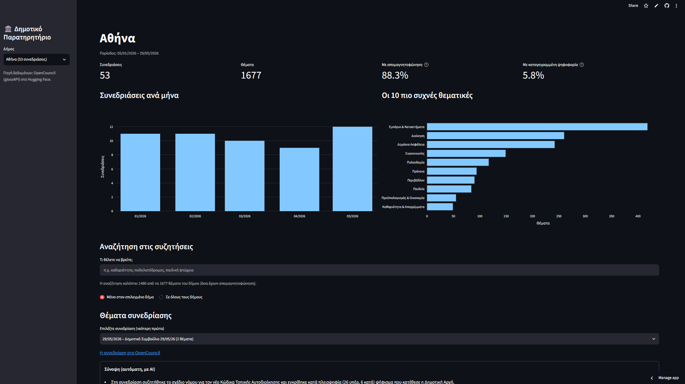
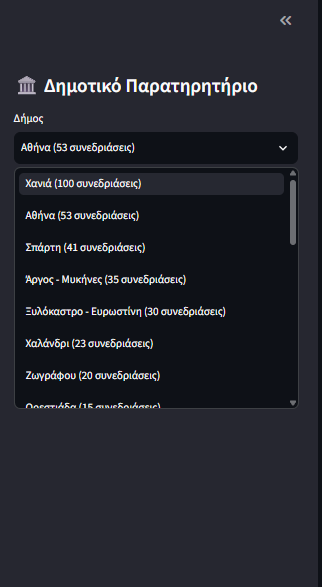
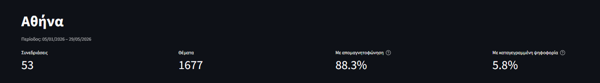
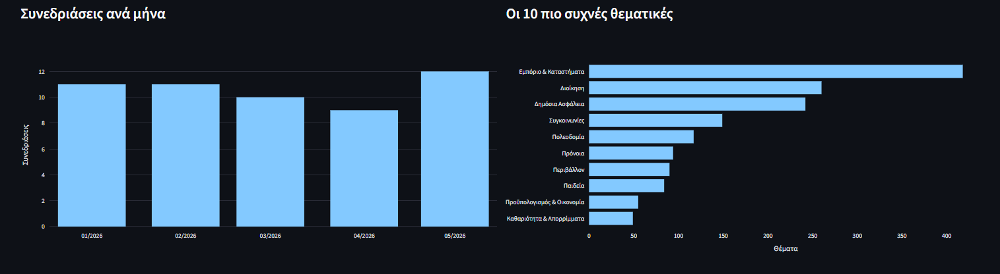
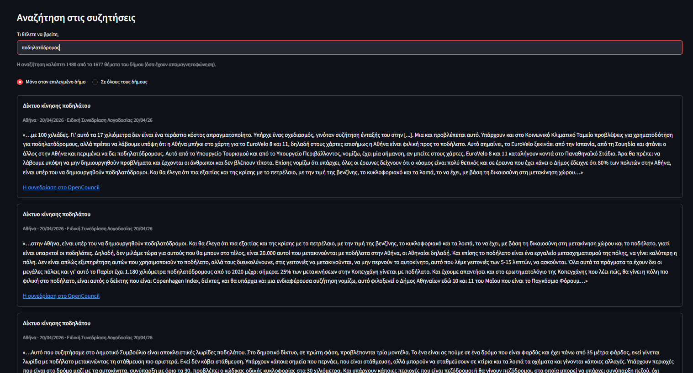
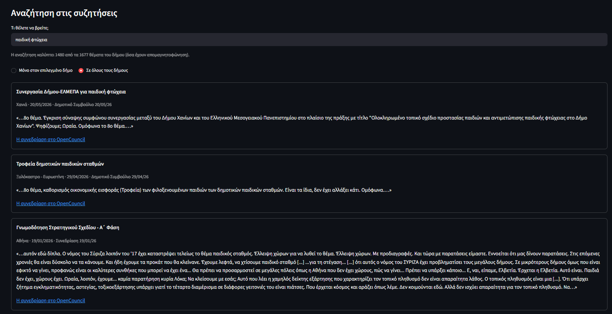
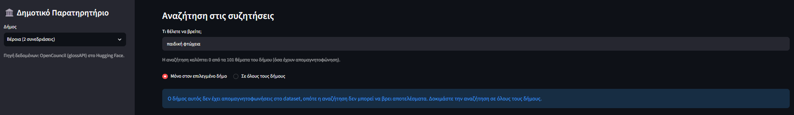
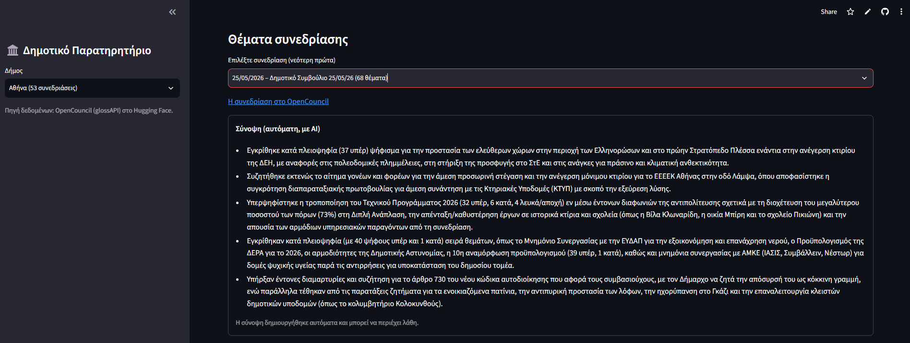
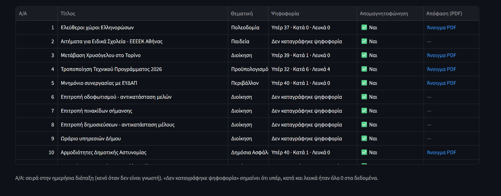

# Οδηγός χρήσης – Δημοτικό Παρατηρητήριο

Το **Δημοτικό Παρατηρητήριο** σας δείχνει τι συζητιέται και τι αποφασίζεται στα δημοτικά συμβούλια 25 δήμων της Ελλάδας. Δεν χρειάζεται εγγραφή ή εγκατάσταση: ανοίγει σε οποιονδήποτε browser, σε υπολογιστή ή κινητό.

Τα δεδομένα προέρχονται από την πλατφόρμα [OpenCouncil.gr](https://opencouncil.gr), που καταγράφει τις συνεδριάσεις των δημοτικών συμβουλίων.

---

## Περιεχόμενα

1. [Πώς ανοίγω την εφαρμογή](#1-πώς-ανοίγω-την-εφαρμογή)
2. [Πώς διαλέγω δήμο](#2-πώς-διαλέγω-δήμο)
3. [Τι σημαίνουν τα νούμερα](#3-τι-σημαίνουν-τα-νούμερα)
4. [Τι δείχνουν τα γραφήματα](#4-τι-δείχνουν-τα-γραφήματα)
5. [Πώς κάνω αναζήτηση](#5-πώς-κάνω-αναζήτηση)
6. [Πώς διαβάζω τα αποτελέσματα της αναζήτησης](#6-πώς-διαβάζω-τα-αποτελέσματα-της-αναζήτησης)
7. [Πώς βλέπω τη σύνοψη και τα θέματα μιας συνεδρίασης](#7-πώς-βλέπω-τη-σύνοψη-και-τα-θέματα-μιας-συνεδρίασης)
8. [Τι σημαίνει «Δεν καταγράφηκε ψηφοφορία»](#8-τι-σημαίνει-δεν-καταγράφηκε-ψηφοφορία)
9. [Συχνές ερωτήσεις](#9-συχνές-ερωτήσεις)
10. [Μικρό λεξικό](#10-μικρό-λεξικό)

---

## 1. Πώς ανοίγω την εφαρμογή

1. Ανοίξτε τον browser σας (Chrome, Firefox, Edge, Safari κ.λπ.).
2. Πηγαίνετε στη διεύθυνση: **<https://dimotiko-paratiritirio.streamlit.app>**
3. Περιμένετε να φορτώσει η σελίδα. Αν δείτε το μήνυμα «Φόρτωση δεδομένων…» ή κάποιο εικονίδιο που γυρίζει, η εφαρμογή ετοιμάζεται. Αυτό μπορεί να πάρει μέχρι και 1–2 λεπτά την πρώτη φορά (δείτε τις [Συχνές ερωτήσεις](#γιατί-η-εφαρμογή-αργεί-την-πρώτη-φορά)).

Όταν φορτώσει, θα δείτε αριστερά την **πλαϊνή μπάρα** με την επιλογή δήμου και στο κέντρο τη σελίδα του δήμου.

> 📱 **Σε κινητό:** η πλαϊνή μπάρα είναι κρυμμένη. Πατήστε το βελάκι **>** πάνω αριστερά για να την ανοίξετε.

Όλη η εφαρμογή είναι **μία σελίδα**. Κάντε κύλιση προς τα κάτω για να δείτε, με τη σειρά: τα νούμερα, τα γραφήματα, την αναζήτηση και τα θέματα των συνεδριάσεων.

---

## 2. Πώς διαλέγω δήμο

1. Στην πλαϊνή μπάρα, κάτω από τον τίτλο «🏛️ Δημοτικό Παρατηρητήριο», υπάρχει το πεδίο **«Δήμος»**.
2. Πατήστε πάνω του για να ανοίξει η λίστα.
3. Διαλέξτε τον δήμο που σας ενδιαφέρει. Μπορείτε επίσης να αρχίσετε να γράφετε το όνομα (π.χ. «Αθ») για να τον βρείτε πιο γρήγορα.

Οι δήμοι είναι ταξινομημένοι από αυτόν με τις **περισσότερες συνεδριάσεις** προς αυτόν με τις λιγότερες. Δίπλα σε κάθε όνομα φαίνεται σε παρένθεση πόσες συνεδριάσεις υπάρχουν, π.χ. «Αθήνα (53 συνεδριάσεις)». Ο πρώτος δήμος της λίστας επιλέγεται αυτόματα όταν ανοίγει η εφαρμογή.

Μόλις αλλάξετε δήμο, όλη η σελίδα ενημερώνεται για τον νέο δήμο.

> ℹ️ Πολλοί δήμοι έχουν μόνο 1 ή 2 συνεδριάσεις στα δεδομένα. Για να δείτε όλες τις δυνατότητες της εφαρμογής, ξεκινήστε από την **Αθήνα**, που έχει και αυτόματες συνόψεις.

---

## 3. Τι σημαίνουν τα νούμερα

Κάτω από το όνομα του δήμου φαίνεται η **περίοδος** που καλύπτουν τα δεδομένα (από την πρώτη έως την τελευταία συνεδρίαση) και τέσσερα βασικά νούμερα:

| Νούμερο | Τι σημαίνει |
|---|---|
| **Συνεδριάσεις** | Πόσες συνεδριάσεις του δημοτικού συμβουλίου υπάρχουν στα δεδομένα για αυτόν τον δήμο. |
| **Θέματα** | Πόσα θέματα συζητήθηκαν συνολικά σε όλες αυτές τις συνεδριάσεις. Κάθε συνεδρίαση έχει πολλά θέματα στην ημερήσια διάταξη. |
| **Με απομαγνητοφώνηση** | Τι ποσοστό των θεμάτων έχει γραπτό κείμενο της συζήτησης. Μόνο σε αυτά τα θέματα μπορεί να γίνει αναζήτηση. |
| **Με καταγεγραμμένη ψηφοφορία** | Τι ποσοστό των θεμάτων έχει καταγεγραμμένο αποτέλεσμα ψηφοφορίας (υπέρ, κατά, λευκά). |

Αν περάσετε τον δείκτη του ποντικιού πάνω από το μικρό ερωτηματικό **(?)** δίπλα στα ποσοστά, θα δείτε τους ακριβείς αριθμούς, π.χ. «1480 από 1677 θέματα».

> 💡 Ένα χαμηλό ποσοστό **δεν** σημαίνει ότι ο δήμος δεν ψηφίζει ή δεν συζητάει. Σημαίνει ότι η πληροφορία δεν υπάρχει στα δεδομένα που έχουμε.

---

## 4. Τι δείχνουν τα γραφήματα

Κάτω από τα νούμερα υπάρχουν δύο γραφήματα, το ένα δίπλα στο άλλο:

**Συνεδριάσεις ανά μήνα** (αριστερά): κάθε στήλη είναι ένας μήνας και το ύψος της δείχνει πόσες συνεδριάσεις έγιναν εκείνον τον μήνα. Οι μήνες χωρίς στήλη είναι μήνες χωρίς καμία συνεδρίαση στα δεδομένα (π.χ. καλοκαιρινές διακοπές).

**Οι 10 πιο συχνές θεματικές** (δεξιά): οι κατηγορίες θεμάτων που εμφανίζονται πιο συχνά στον δήμο, με τη συχνότερη επάνω. Το μήκος κάθε μπάρας δείχνει πόσα θέματα ανήκουν σε αυτή την κατηγορία. Το «Χωρίς θεματική» σημαίνει ότι το θέμα δεν έχει χαρακτηριστεί με κατηγορία στα δεδομένα.

Τα γραφήματα είναι διαδραστικά:

- Περάστε το ποντίκι πάνω από μια στήλη για να δείτε τον ακριβή αριθμό.
- Σύρετε με το ποντίκι πάνω στο γράφημα για να μεγεθύνετε ένα κομμάτι. Με διπλό κλικ επιστρέφετε στην αρχική εικόνα.

---

## 5. Πώς κάνω αναζήτηση

Η ενότητα **«Αναζήτηση στις συζητήσεις»** ψάχνει μέσα σε ό,τι ειπώθηκε στις συνεδριάσεις.

1. Στο πεδίο **«Τι θέλετε να βρείτε;»** γράψτε αυτό που σας ενδιαφέρει, π.χ. *καθαριότητα*, *ποδηλατόδρομος*, *παιδική φτώχεια*.
2. Πατήστε **Enter**.
3. Κάτω από το πεδίο διαλέξτε πού να γίνει η αναζήτηση:
   - **Μόνο στον επιλεγμένο δήμο** (προεπιλογή), ή
   - **Σε όλους τους δήμους**.

Κάτω από το πεδίο φαίνεται πόσα θέματα του δήμου καλύπτει η αναζήτηση, π.χ. «Η αναζήτηση καλύπτει 1480 από τα 1677 θέματα του δήμου (όσα έχουν απομαγνητοφώνηση).»

**Συμβουλές για καλύτερα αποτελέσματα:**

- Η αναζήτηση καταλαβαίνει το **νόημα**, όχι μόνο τις λέξεις. Μια αναζήτηση για «καθαριότητα» βρίσκει και συζητήσεις για «αποκομιδή σκουπιδιών» ή «κάδους απορριμμάτων».
- Γράψτε λίγες, συγκεκριμένες λέξεις (2–4). Δεν χρειάζονται ολόκληρες προτάσεις.
- Γράψτε στα ελληνικά, με κανονική ορθογραφία, όπως θα μιλούσε κάποιος στο συμβούλιο.
- Αν ένας μικρός δήμος δεν βγάζει αποτελέσματα, δοκιμάστε **«Σε όλους τους δήμους»**.

---

## 6. Πώς διαβάζω τα αποτελέσματα της αναζήτησης

Εμφανίζονται έως **10 αποτελέσματα**, με το πιο σχετικό πρώτο. Κάθε αποτέλεσμα είναι ένα πλαίσιο με:

1. **Τίτλος θέματος** (με έντονα γράμματα): το θέμα της ημερήσιας διάταξης στο οποίο ανήκει η συζήτηση.
2. **Δήμος · Ημερομηνία · Συνεδρίαση** (με γκρι γράμματα): πού και πότε ειπώθηκε.
3. **Το απόσπασμα** σε εισαγωγικά «…»: ένα κομμάτι περίπου 200 λέξεων από τη συζήτηση. Οι τελείες στην αρχή και στο τέλος σημαίνουν ότι το κείμενο συνεχίζει.
4. **«Η συνεδρίαση στο OpenCouncil»**: σύνδεσμος για να δείτε ολόκληρη τη συνεδρίαση στο OpenCouncil.gr, με βίντεο και πλήρες κείμενο.

Λάβετε υπόψη:

- Το κείμενο προέρχεται από **αυτόματη απομαγνητοφώνηση** της ομιλίας, οπότε μπορεί να έχει ορθογραφικά λάθη ή λέξεις που «ακούστηκαν» λάθος.
- **Δεν φαίνονται ονόματα ομιλητών**, γιατί δεν υπάρχουν στα δεδομένα.
- Τα αποτελέσματα είναι τα πιο **κοντινά σε νόημα** που βρέθηκαν. Αν το θέμα δεν συζητήθηκε ποτέ, θα εμφανιστούν τα λιγότερο άσχετα, που μπορεί να μην ταιριάζουν. Διαβάστε το απόσπασμα για να κρίνετε.

Αν διαλέξετε «Μόνο στον επιλεγμένο δήμο» για έναν δήμο που δεν έχει καμία απομαγνητοφώνηση, θα δείτε αυτό το μήνυμα:

---

## 7. Πώς βλέπω τη σύνοψη και τα θέματα μιας συνεδρίασης

Στο κάτω μέρος της σελίδας είναι η ενότητα **«Θέματα συνεδρίασης»**.

### Επιλογή συνεδρίασης

1. Πατήστε στο πεδίο **«Επιλέξτε συνεδρίαση (νεότερη πρώτα)»**.
2. Διαλέξτε μια συνεδρίαση. Κάθε επιλογή δείχνει ημερομηνία, όνομα συνεδρίασης και πλήθος θεμάτων, π.χ. «25/05/2026 – Δημοτικό Συμβούλιο 25/05/26 (68 θέματα)».
3. Ο σύνδεσμος **«Η συνεδρίαση στο OpenCouncil»** ανοίγει την ίδια συνεδρίαση στο OpenCouncil.gr.

### Η σύνοψη

Αμέσως από κάτω υπάρχει το πλαίσιο **«Σύνοψη (αυτόματη, με AI)»**, με 4–6 κουκκίδες που περιγράφουν:

- τα κύρια θέματα που συζητήθηκαν,
- τι αποφασίστηκε,
- πού υπήρξε διαφωνία.

Η σύνοψη γράφτηκε αυτόματα από πρόγραμμα τεχνητής νοημοσύνης, με βάση τους τίτλους, τις ψηφοφορίες και τις απομαγνητοφωνήσεις. Όπως γράφει και η σημείωση από κάτω, **μπορεί να περιέχει λάθη**. Για σημαντικά ζητήματα, ελέγξτε τον πίνακα θεμάτων ή την πλήρη συνεδρίαση στο OpenCouncil.gr.

Αυτή τη στιγμή συνόψεις υπάρχουν **μόνο για την Αθήνα**. Για τους άλλους δήμους θα δείτε «Δεν υπάρχει διαθέσιμη σύνοψη για αυτή τη συνεδρίαση».

### Ο πίνακας θεμάτων

Κάτω από τη σύνοψη, ο πίνακας δείχνει όλα τα θέματα της συνεδρίασης με τη σειρά της ημερήσιας διάταξης:

| Στήλη | Τι δείχνει |
|---|---|
| **Α/Α** | Ο αριθμός του θέματος στην ημερήσια διάταξη. «—» όταν δεν είναι γνωστός. |
| **Τίτλος** | Ο τίτλος του θέματος, όπως γράφτηκε στην ημερήσια διάταξη. |
| **Θεματική** | Η κατηγορία του θέματος (π.χ. Περιβάλλον, Οικονομικά). |
| **Ψηφοφορία** | Το αποτέλεσμα, π.χ. «Υπέρ 26 · Κατά 6 · Λευκά 0», ή «Δεν καταγράφηκε ψηφοφορία» (δείτε την επόμενη ενότητα). |
| **Απομαγνητοφώνηση** | «✅ Ναι» αν υπάρχει γραπτό κείμενο της συζήτησης για το θέμα, «— Όχι» αν δεν υπάρχει. |
| **Απόφαση (PDF)** | Σύνδεσμος «Άνοιγμα PDF» για το επίσημο έγγραφο της απόφασης, όταν υπάρχει. «—» αν δεν υπάρχει. |

Χρήσιμα κόλπα με τον πίνακα:

- Πατήστε στην επικεφαλίδα μιας στήλης για **ταξινόμηση** (π.χ. για να μαζευτούν όλα τα θέματα με ψηφοφορία).
- Αν ένας τίτλος είναι μεγάλος και κόβεται, περάστε το ποντίκι από πάνω του ή κάντε διπλό κλικ για να τον δείτε ολόκληρο.
- Με το εικονίδιο πάνω δεξιά στον πίνακα μπορείτε να τον δείτε σε **πλήρη οθόνη**, να **ψάξετε** μέσα του ή να τον **κατεβάσετε** ως αρχείο CSV.

---

## 8. Τι σημαίνει «Δεν καταγράφηκε ψηφοφορία»

Στα δεδομένα, για τα περισσότερα θέματα οι ψήφοι υπέρ, κατά και λευκά είναι όλες **0**. Αυτό **δεν** σημαίνει ότι κανείς δεν ψήφισε, ούτε ότι το θέμα απορρίφθηκε. Σημαίνει απλώς ότι **το αποτέλεσμα της ψηφοφορίας δεν καταγράφηκε** στα δεδομένα. Γι' αυτό, αντί για «Υπέρ 0 · Κατά 0 · Λευκά 0», η εφαρμογή γράφει **«Δεν καταγράφηκε ψηφοφορία»**.

Αυτό συμβαίνει συχνά: σε όλους τους δήμους μαζί, μόνο περίπου **6 στα 100 θέματα** έχουν καταγεγραμμένη ψηφοφορία. Σε πολλούς δήμους δεν υπάρχει καμία.

Αν θέλετε να μάθετε τι αποφασίστηκε για ένα τέτοιο θέμα:

- ανοίξτε το **PDF της απόφασης**, αν υπάρχει,
- διαβάστε τη **σύνοψη** (για την Αθήνα), που μερικές φορές αναφέρει την ψηφοφορία από τη συζήτηση,
- ή δείτε τη συνεδρίαση στο **OpenCouncil.gr**.

---

## 9. Συχνές ερωτήσεις

### Γιατί η εφαρμογή αργεί την πρώτη φορά;

Η εφαρμογή φιλοξενείται δωρεάν. Όταν δεν τη χρησιμοποιεί κανείς για αρκετό καιρό, «κοιμάται» για να μην καταναλώνει πόρους. Η πρώτη επίσκεψη μετά την ξυπνάει: πρέπει να ξεκινήσει ξανά και να φορτώσει τα δεδομένα. Αν δείτε μήνυμα ότι η εφαρμογή κοιμάται, πατήστε το κουμπί για να την ξυπνήσετε και περιμένετε 1–2 λεπτά.

Η **πρώτη αναζήτηση** επίσης αργεί λίγο περισσότερο, γιατί τότε φορτώνεται το «μοντέλο» που καταλαβαίνει το νόημα των λέξεων. Οι επόμενες αναζητήσεις είναι γρήγορες.

### Γιατί κάποιος δήμος δεν έχει αποτελέσματα αναζήτησης;

Η αναζήτηση ψάχνει μόνο μέσα στις **απομαγνητοφωνήσεις**, δηλαδή στο γραπτό κείμενο των συζητήσεων. Εννέα δήμοι δεν έχουν καμία απομαγνητοφώνηση στα δεδομένα (Βάρη Βούλα Βουλιαγμένη, Βέροια, Καλαμάτα, Δωρίδα, Αττική, Πάτρα, Νέα Σμύρνη, Ρόδος, Περιστέρι), και άλλοι έχουν πολύ λίγες. Ελέγξτε το νούμερο **«Με απομαγνητοφώνηση»** στην κορυφή της σελίδας: αν είναι 0%, η αναζήτηση στον δήμο δεν μπορεί να βρει τίποτα. Δοκιμάστε **«Σε όλους τους δήμους»**.

### Γιατί κάποιος δήμος δεν έχει σύνοψη;

Οι συνόψεις φτιάχνονται με υπηρεσία τεχνητής νοημοσύνης που, στη δωρεάν εκδοχή της, επιτρέπει λίγες συνόψεις την ημέρα. Γι' αυτό μέχρι στιγμής έχουν φτιαχτεί μόνο για τις 53 συνεδριάσεις της **Αθήνας**. Για τους υπόλοιπους δήμους θα δείτε «Δεν υπάρχει διαθέσιμη σύνοψη για αυτή τη συνεδρίαση». Τα θέματα και οι ψηφοφορίες στον πίνακα εμφανίζονται κανονικά.

### Γιατί η αναζήτηση φέρνει αποτελέσματα που δεν ταιριάζουν ακριβώς;

Η αναζήτηση φέρνει πάντα τα 10 αποσπάσματα που μοιάζουν περισσότερο σε νόημα με αυτό που γράψατε, ακόμη κι αν κανένα δεν είναι ακριβώς αυτό που ψάχνετε. Δοκιμάστε πιο συγκεκριμένες λέξεις ή άλλη διατύπωση. Στη δική μας δοκιμή, κατά μέσο όρο τα 4 από τα 5 πρώτα αποτελέσματα ήταν σχετικά.

### Γιατί δεν βλέπω ποιος μίλησε ή τι ψήφισε κάθε σύμβουλος;

Τα δεδομένα δεν περιέχουν ονόματα ομιλητών ούτε ψήφους ανά σύμβουλο, μόνο το συνολικό αποτέλεσμα (όταν καταγράφηκε).

### Είναι τα δεδομένα ενημερωμένα;

Η εφαρμογή χρησιμοποιεί ένα στιγμιότυπο των δεδομένων του Ιουνίου 2026. Νεότερες συνεδριάσεις δεν εμφανίζονται. Για τις πιο πρόσφατες, δείτε απευθείας το [OpenCouncil.gr](https://opencouncil.gr).

### Μπορώ να εμπιστευτώ τις συνόψεις;

Στη δοκιμή μας οι συνόψεις βαθμολογήθηκαν με 4,4 στα 5 για ακρίβεια και δεν βρέθηκαν επινοημένες πληροφορίες. Παρ' όλα αυτά, γράφονται αυτόματα και μπορεί να έχουν λάθη ή παραλείψεις. Χρησιμοποιήστε τις για μια γρήγορη εικόνα και ελέγξτε την πηγή για οτιδήποτε σημαντικό.

### Χρειάζεται να πληρώσω ή να φτιάξω λογαριασμό;

Όχι. Η εφαρμογή είναι δωρεάν και ανοιχτή σε όλους.

---

## 10. Μικρό λεξικό

| Όρος | Εξήγηση |
|---|---|
| **Συνεδρίαση** | Μία συνάντηση του δημοτικού συμβουλίου, με συγκεκριμένη ημερομηνία. |
| **Θέμα** | Ένα σημείο της ημερήσιας διάταξης μιας συνεδρίασης, για το οποίο γίνεται συζήτηση και συνήθως λαμβάνεται απόφαση. |
| **Ημερήσια διάταξη** | Η λίστα των θεμάτων μιας συνεδρίασης, με τη σειρά που θα συζητηθούν. |
| **Θεματική** | Η γενική κατηγορία ενός θέματος (π.χ. Περιβάλλον, Παιδεία). |
| **Απομαγνητοφώνηση** | Η μετατροπή της ηχογραφημένης συζήτησης σε γραπτό κείμενο. |
| **Σύνοψη με AI** | Σύντομη περίληψη που γράφτηκε αυτόματα από πρόγραμμα τεχνητής νοημοσύνης. |
| **Σημασιολογική αναζήτηση** | Αναζήτηση που βρίσκει κείμενα με παρόμοιο **νόημα**, όχι μόνο με τις ίδιες λέξεις. |
